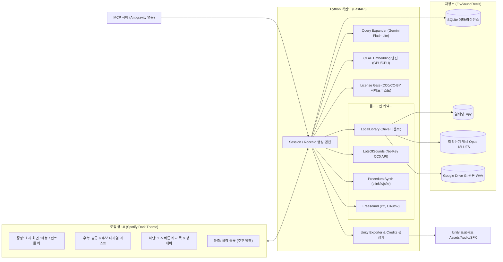

# 🎧 SoundReels — 게임 사운드 탐색기 기획서 (v1.1)

> AI가 **찾고 줄 세우기**까지 맡고, 사람은 **듣고 결정**만 한다. **Spotify 감성의 몰입형 플레이어 + 릴스식 초고속 넘기기**를 결합한 게임 SFX 큐레이션 도구.

---

## 1. 목표 / 비목표

| 구분 | 내용 |
|---|---|
| **목표** | ① 필요한 소리 목록 → AI가 후보 자동 수집·정렬 ② **Spotify 스타일 다크 플레이어**에서 키 하나로 듣고 넘기기 ③ 찜·"비슷한 것 더"·"즉석 합성/변형"으로 탐색 수렴 ④ **상업 게임에 그대로 넣어도 되는 소리만** 노출 ⑤ 사이트 일일이 방문 제거 |
| **비목표** | 복잡한 멀티트랙 DAW 편집, AI가 최종 선택, 약관 위반 스크래핑, 소리 파일 불법 재배포 |
| **사용자 및 저장소** | 본인/소수 팀 내부 도구로 시작, 향후 무료·오픈소스 배포 고려 → GitHub (`sonminki07/SoundReels`, 초기 Private) 및 로컬 작업 공간 `E:\SoundReels` |

---

## 2. 인터뷰 결정사항 요약 (Q1 ~ Q13)

| # | 결정 항목 | 확정 내용 |
|---|---|---|
| **Q1** | 사운드 공급 | **하이브리드** — 로컬 라이브러리 주력 + 온라인 CC0/CC-BY API + 절차적 생성기 보조 |
| **Q2** | 형태 | **Python 백엔드(FastAPI) + 로컬 웹 UI**, Unity 폴더로 즉시 내보내기 |
| **Q3** | 배포 범위 | 내부 도구로 시작하되 **무료 배포(오픈소스) 가능성** 고려 (소리 미동봉, 각자 키 사용) |
| **Q4** | 검색어 확장 | **Gemini Flash-Lite API** 기본 + 수동 영어 모드 + **MCP 서버**(Antigravity 연동) |
| **Q5** | 넘기기 피드백 | **적응형 재정렬(Rocchio)** — 찜 당김 / 건너뛰기 약하게 밀기 / "비슷한 것" 기준 전환 |
| **Q6** | 목록 구조 | **프로젝트 → 슬롯 → 후보(찜)/확정**, 슬롯당 다수 확정(변주) 허용, 메모/길이 조건 |
| **Q7** | 라이선스 | **CC0 + CC-BY 허용**, BY 배지·`CREDITS.txt` 자동 생성, "CC0만 보기" 토글 |
| **Q8** | 결과 표시 | **통합 대기열** — 외부 API 결과도 미리듣기로 로컬 CLAP 재채점 후 한 줄로 통합 |
| **Q9** | 라이브러리 | **Google Drive 스트리밍 마운트(원본) + 로컬 색인 + 로컬 미리듣기 캐시 + 프리페치** |
| **Q10** | Unity 내보내기 | **원본 보존**, 슬롯 이름 규칙, 선택적 무음제거/노멀라이즈(기본 끔), 라이선스 매니페스트 |
| **Q11** | 개발 단계 | **P0 품질 검증 → P1 MVP → P2 확장** |
| **Q12** | 오픈소스 통합 | **LotsOfSounds API**(키 불필요 CC0, P1 기본 탑재) + **plinkfx/jsfxr 절차적 생성기** 통합 |
| **Q13** | GitHub 연동 | **`sonminki07/SoundReels` (Private)** 생성 + 로컬 **`E:\SoundReels`** 에서 Git 버전 관리 |

---

## 3. 핵심 해결책 — "여러 사이트 연결 및 오픈소스 통합"

### 3.1 사운드 소스 & 오픈소스 평가 매트릭스

| 소스 / 오픈소스 | 유형 | 인증/API 키 | 상업적 라이선스 | 연결 방식 및 단계 |
|---|---|---|---|---|
| **로컬 사운드 팩** (Sonniss GDC, Kenney, 보유 에셋) | 로컬 파일 (Drive 마운트) | 불필요 | ✅ 로열티 프리 / CC0 / Unity EULA | **LocalLibrary 커넥터 (P0~P1 주력)** |
| **`lotsofsounds/free-sound-effects-api`** | 공식 REST API & MCP | **불필요 (No-Key)** | ✅ **12,000+ 전량 CC0** (출처 표기 불필요) | **LotsOfSounds 커넥터 (P1 기본 온라인 소스)** |
| **`maximilianfeix/plinkfx` & `chr15m/jsfxr`** | 코드 기반 절차적 SFX 합성 | 불필요 (로컬/WebAudio) | ✅ **전량 CC0** (274종+ 프리셋 & Mutate 변형) | **ProceduralSynth 커넥터 (P1~P2 즉석 생성/변형)** |
| **Freesound API** | 공식 REST API + OAuth2 | API Key + OAuth2 필요 | ⚠️ 필터 필수 (CC0 / CC-BY만 허용) | **Freesound 커넥터 (P2 확장 온라인 소스)** |
| Pixabay / Zapsplat / Mixkit | 웹 사이트 (오디오 API 없음) | — | 사이트별 상이 | ❌ 스크래핑 금지 → 수동 다운로드 후 **팩 가져오기**로만 등록 |
| BBC Sound Effects | 웹 사이트 | — | ❌ 비상업 전용 | ⛔ **코드 레벨 차단** |

### 3.2 오픈소스 벤치마킹 & 아키텍처 흡수
공유해주신 오픈소스 목록의 핵심 장점을 SoundReels에 다음과 같이 흡수합니다:
1. **`TaaroBravo/semantic-audio-search`**: LAION-CLAP 기반 시맨틱 인덱싱 및 자연어 검색 파이프라인 참조 (단, 무거운 Qdrant 서버 대신 10만 개 이하에서는 설치가 필요 없는 로컬 `numpy` 메모리 맵 + `SQLite`로 경량화).
2. **`pixelriot/SFX-Browser`**: 방향키만으로 딜레이 없이 트랙을 넘기고 즐겨찾기 후 프로젝트 폴더로 일괄 이름을 바꿔 추출(Batch Rename & Export)하는 워크플로우 흡수.
3. **`interactiveaudiolab/SoundSeek`**: 음색(Timbral) 유사도 탐색 개념을 흡수하여, 중앙 `소리 화면`에 스펙트로그램/음색 컬러 비주얼라이저를 표시하고 `[F 비슷한 소리]`로 기준점을 옮겨 다니는 탐색 제공.
4. **`lotsofsounds/free-sound-effects-api`**: API 키 없이 즉시 호출 가능한 `GET https://api.lotsofsounds.com/api/v1/sounds/sample?q=...&limit=12` 엔드포인트를 P1 MVP부터 연결하여, 로컬 팩이 적을 때도 즉시 CC0 사운드를 스트리밍하고 CLAP으로 재채점.
5. **`plinkfx` / `jsfxr` / `game-sounds`**: UI 클릭, 코인, 레이저, 타격음 등 레트로/모던 게임 효과음이 필요할 때 기존 파일을 찾는 것을 넘어 **[🎲 즉석 변형(Mutate) 생성]** 버튼으로 4가지 미세 테이크를 즉석 합성해 바로 채택 가능.

---

## 4. UI / UX 설계 — Spotify 감성 & 사용자 스케치 반영

````carousel

<!-- slide -->

````

### 4.1 화면 레이아웃 매핑 (스케치 × Spotify 다크 테마)

```
┌───────────────────────────────────────────────────────────────────────────────────┐
│  < >   🏠  [ 🔍 슬롯 검색 / 자연어 프롬프트 입력 (예: 무거운 철문 닫힘)         ]    ⚙️ │ ← 상단 바 (Spotify 스타일)
├───────────────┬───────────────────────────────────────────────────┬───────────────┤
│               │                                                   │  📋 리스트     │
│  (좌측 영역)   │             ┌───────────────────────┐             │  (우측 사이드) │
│  추후 확장용   │             │                       │             │               │
│  접이식 패널   │             │       소리 화면        │             │ [필요한 슬롯] │
│               │             │  (앨범아트형 비주얼)   │             │ ● 철문 닫힘 ▶ │
│  (초기에는     │             │  스펙트로그램 + 파형   │             │ ○ UI 확인음   │
│   비워두거나   │             │   음색 기반 배경색     │             │ ✔ 발소리 (3)  │
│   접어두고,    │             └───────────────────────┘             │               │
│   추후 팩 필터 │                                                   │ ───────────── │
│   / AI 프롬프트│         ┌───────────────────────────────┐         │ [현재 대기열] │
│   튜너 / 음색  │         │  메뉴: [⭐찜] [🔀비슷] [🎲변형] [✅채택] │         │ 1. gate_02 92%│
│   맵 배치)     │         └───────────────────────────────┘         │ 2. door_11 89%│
│               │                                                   │ 3. fs_1338 85%│
│               │   ┌───────────────────────────────────────────┐   │               │
│               │   │  컨트롤 바: ⏮  ⏯  ⏭  🔁   0:01 ━━●━━ 0:03 │   │ [⭐ 찜 / 확정]│
│               │   └───────────────────────────────────────────┘   │  door_03.wav  │
├───────────────┴───────────────────────────────────────────────────┴───────────────┤
│  [ 찜 1 ] [ 찜 2 ] [ 찜 3 ] [ 찜 4 ] [ 찜 5 ]      ●  ●  ●  ●  ○   🔊 ━━━  [Unity 내보내기] │ ← 하단 바 (스케치 반영)
└───────────────────────────────────────────────────────────────────────────────────┘
```

### 4.2 스케치의 5대 핵심 영역 상세
1. **중앙 상단 `소리 화면` (Spotify 앨범 아트 스타일)**:
   - 오디오에는 앨범 커버가 없으므로, 소리의 **주파수 대역과 음색(Timbre)에 따라 Spotify처럼 배경 그라데이션 색상이 동적으로 변합니다** (예: 묵직한 저음 폭발 = 짙은 크림슨 레드, 날카로운 금속음 = 시안 블루, 밝은 UI 차임 = 앰버 골드).
   - 중앙 정사각형 카드 안에 **실시간 스펙트로그램/파형 비주얼라이저**, 파일명, 출처 배지(`[LOCAL·Sonniss]`, `[LotsOfSounds·CC0]`, `[Synth·CC0]`), 유사도(`94% Match`)가 깔끔하게 표시됩니다.
2. **중앙 중단 `메뉴` (빠른 판정 액션 바)**:
   - 듣고 마음에 들면 클릭하거나 단축키로 즉시 실행하는 핵심 액션 버튼 바입니다.
   - `[⭐ 찜(중간저장) (S)]` · `[🔀 이 소리랑 비슷한 것 (F)]` · `[🎲 즉석 미세변형 테이크 생성 (M)]` · `[✅ 슬롯 확정 채택 (Enter)]`
3. **중앙 하단 `컨트롤 바` (전용 트랜스포트)**:
   - 이전 소리(`↑`), 재생/일시정지(`Space`), 다음 소리/넘기기(`↓`), 반복 재생(`L`), 파형 위 구간 스크러빙(드래그로 원하는 타격 지점 바로 듣기).
4. **우측 `리스트` (사운드 슬롯 & 추천 대기열)**:
   - 상단 탭 전환 또는 상하 분할로 **[내가 찾아야 할 사운드 슬롯 리스트]** 와 **[현재 슬롯의 AI 추천 사운드 대기열 + 찜/확정 목록]** 을 한눈에 보여줍니다.
5. **하단 `슬롯 독(□ □ □ □ □) & 상태 표시줄(○ ○ ○)`**:
   - 스케치 하단의 네모 박스(`□ □ □ □ □`)는 **현재 슬롯에 임시 찜해둔 사운드 슬롯(Quick Compare Dock, 숫자키 `1`~`5`로 즉시 번갈아 비교 청취)** 또는 **최근 히스토리 카드**로 동작합니다. A 후보와 B 후보 중 뭐가 더 나은지 숫자키 `1`, `2`만 눌러 바로 비교할 수 있습니다.
   - 우측 동그라미 영역에는 소스 필터 상태(로컬/온라인/CC0 전용), 볼륨 노멀라이즈 토글, `[Unity로 내보내기]` 버튼이 위치합니다.
6. **좌측 영역 (`보고 하는 걸로` — 유연한 슬롯 설계)**:
   - 초기(P1)에는 미니멀하게 접어두어 중앙 플레이어 몰입감을 극대화합니다.
   - 사용하면서 필요에 따라 ① **AI 확장 프롬프트 칩 편집기**(Gemini가 만든 영어 키워드 켜고 끄기), ② **보유 사운드 팩/폴더 트리**, ③ **SoundSeek 스타일 2D 음색 맵**, ④ **크레딧/라이선스 상세 카드**(Spotify 하단 '아티스트 상세정보 / 크레딧' 카드 스타일) 중 원하는 위젯을 꽂을 수 있도록 비워둡니다.

---

## 5. 시스템 아키텍처



---

## 6. GitHub 저장소 및 디렉터리 구조 (`E:\SoundReels`)

> [!IMPORTANT]
> 오픈소스 배포 가능성과 저작권 보호를 위해 **사운드 원본 파일, 미리듣기 캐시, CLAP 임베딩 벡터(.npy/.pt), 로컬 DB(.db), API 키(.env)** 는 `.gitignore`로 철저히 제외하고 코드와 문서만 Git에 커밋합니다.

```text
E:\SoundReels\                  (GitHub: sonminki07/SoundReels - Private)
├── docs/
│   └── PLAN.md                 # 본 기획서 (버전 관리)
├── backend/
│   ├── app/
│   │   ├── main.py             # FastAPI 엔트리포인트
│   │   ├── core/               # CLAP 임베딩, Rocchio 재정렬, License Gate
│   │   ├── connectors/         # local_drive.py, lotsofsounds.py, synth_plinkfx.py, freesound.py
│   │   ├── services/           # query_expander.py (Gemini), unity_exporter.py
│   │   └── mcp_server.py       # Antigravity 연동 MCP 서버
│   └── requirements.txt
├── frontend/                   # Vite + React + TypeScript (Spotify Dark UI)
│   ├── src/
│   │   ├── components/         # SoundScreen, ActionMenu, TransportBar, RightList, CompareDock
│   │   └── ...
├── scripts/
│   └── p0_benchmark.py         # P0 CLAP 검색 품질 & GTX 1060 호환성 검증 스크립트
├── data/                       # [.gitignore 제외] 로컬 SQLite, 임베딩(.npy), Opus 미리듣기 캐시
├── .gitignore
└── README.md
```

---

## 7. 핵심 알고리즘 & 기능 요약

### 7.1 검색어 확장 & 적응형 재정렬 (Rocchio)
- **한국어 슬롯 → 영어 확장**: Gemini Flash-Lite가 슬롯(`철문 닫힘 | 무겁고 녹슨 느낌`)을 CLAP용 영어 묘사 3~5개 + API 태그 + 네거티브 프롬프트로 변환.
- **적응형 쿼리 벡터**:

$$
\mathbf{q} = \text{norm}\Big(\overline{\mathbf{t}} - \gamma\,\overline{\mathbf{n}} + \alpha\,\overline{\mathbf{liked}} - \beta\,\overline{\mathbf{skipped}}\Big)
$$

  - `S(찜)`를 누르면 해당 소리 방향으로 대기열이 당겨지고, `↓(넘기기)`를 누르면 약하게 밀어내어 넘길수록 내 취향의 소리가 위로 올라옵니다.
  - `F(비슷한 소리)`를 누르면 해당 오디오 임베딩을 새로운 기준점(Anchor)으로 삼아 대기열을 즉시 재정렬하며, `Backspace`로 이전 기준점으로 돌아갑니다.

### 7.2 단축키 체계 (릴스 + Spotify 결합)
| 단축키 | 동작 |
|---|---|
| `↓` / `J` | 다음 소리로 넘기기 (자동 재생 + 약한 negative 반영) |
| `↑` / `K` | 이전 소리로 돌아가기 |
| `Space` | 재생 / 일시정지 (또는 처음부터 다시 듣기) |
| `S` | **찜(중간저장)** → 하단 비교 독(`□ □ □ □ □`) 및 우측 찜 목록에 추가 |
| `1` ~ `5` | 하단 비교 독에 담긴 찜 후보 1~5번 즉시 비교 재생 |
| `F` | **이 소리와 비슷한 소리**로 대기열 재정렬 (Anchor 이동) |
| `M` | **즉석 변형(Mutate)** — 비슷한 파형/피치 변주 또는 plinkfx 테이크 생성 |
| `Backspace` | 이전 검색 기준으로 되돌리기 |
| `Enter` | **최종 확정(채택)** → Unity 폴더 복사 및 라이선스/크레딧 자동 기록 |

---

## 8. 단계별 개발 로드맵

### P0 — 엔진 품질 검증 & GitHub 세팅 (1~2일)
- `sonminki07/SoundReels` GitHub 비공개 저장소 생성 및 `E:\SoundReels` 초기 커밋
- Python 3.11 환경 및 GTX 1060(3GB) PyTorch CUDA 호환성 확인
- 소규모 샘플(Kenney CC0 + LotsOfSounds API 샘플)로 CLAP 텍스트/유사음 검색 `Precision@10 ≥ 50%` 검증

### P1 — MVP (핵심 워크플로우 완성)
- **백엔드**: LocalLibrary 커넥터(Google Drive 마운트 + 로컬 Opus 캐시), **LotsOfSounds 커넥터**(무인증 CC0), Gemini Flash-Lite 검색어 확장, Rocchio 적응형 랭킹, Unity Exporter(`Audio_Licenses.json` / `CREDITS.txt`)
- **프런트엔드**: 스케치 기반 **Spotify 다크 테마 UI** (`소리 화면`, `메뉴`, `컨트롤 바`, 우측 `리스트`, 하단 `1~5 빠른 비교 독`)
- **생성기 기초**: `plinkfx` / `jsfxr` 연동으로 기본 게임 효과음 즉석 합성/변형

### P2 — 확장
- **Freesound 커넥터** (OAuth2 원본 다운로드, CC0/CC-BY 필터)
- **Antigravity 연동 MCP 서버** (`add_slots`, `expand_slot`, `slot_status`)
- **좌측 패널 위젯 추가** (사용해보며 결정: 프롬프트 칩 튜너 / 2D 음색 맵 / 팩 브라우저)
- 선택적 오디오 후처리 (무음 트림, 피크 노멀라이즈)

---

## 9. 🔍 검토 (Reviewer) — 추가된 리스크 & 대응 (v1.1)

기존 R1~R18 리스크(CLAP 정확도, GTX 1060 호환성, Drive 스트리밍 지연, 라우드니스 편향 등)에 더해 v1.1 변경사항에 대한 검토를 추가했습니다.

| # | 신규 리스크 / 엣지 케이스 | 영향 | 대응 |
|---|---|---|---|
| **R19** | **LotsOfSounds 무료 샘플 API의 쿼리당 최대 12개 제한 및 네트워크 지연** | 온라인 후보 수 부족 또는 넘기기 버퍼링 | 로컬 라이브러리를 주력으로 두고 LotsOfSounds는 슬롯 선택 시 백그라운드로 비동기 페치하여 미리듣기 캐시에 합류. 3~5개 확장 키워드로 병렬 조회해 최대 30~40개 풀 확보 |
| **R20** | **절차적 생성기(plinkfx/jsfxr) 소리가 실사 게임 톤앤매너와 이질적일 수 있음** | 실사풍 슬롯에 8비트/신스 소리가 섞임 | 일반 검색 대기열에 무조건 섞지 않고, UI `메뉴`의 `[🎲 즉석 합성/변형 (M)]` 버튼이나 `신스/UI/레트로` 태그 슬롯에서만 깔끔하게 호출되도록 분리 |
| **R21** | **GitHub에 대용량 오디오/임베딩/API 키가 실수로 커밋될 위험** | 저작권 위반 및 보안 사고, 용량 초과 | 초기 커밋 시 강력한 `.gitignore`(`*.wav`, `*.ogg`, `*.mp3`, `*.opus`, `*.npy`, `*.pt`, `*.db`, `.env`, `data/`)를 최우선 적용하고 초기 저장소는 **Private**으로 유지 |
| **R22** | **하단 비교 독(`□ □ □ □ □`)에서 찜이 5개를 초과할 때의 UX** | 하단 바 넘침 | 하단 독에는 최근 또는 핀 고정한 핵심 5개(`1`~`5`번 단축키)를 노출하고, 전체 찜 목록은 우측 `리스트`의 `[⭐ 찜]` 섹션 및 가로 스크롤로 관리 |
